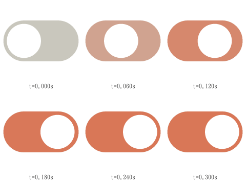

# Anima

An open animation format and a small web runtime for animated, interactive UI: icons, toggles,
buttons, sliders, cards, toolbars and other controls. Think of it as a smaller Rive that agents can
write, built for the browser.

- **Written as text.** Scenes are authored in AniML, a readable XML markup, and compiled to `.ani`,
  a JSON format. An agent, or a person, can write one, validate it, run it headlessly and look at
  the frames, all from the command line.
- **Strict and deterministic.** Every problem comes with a code, a JSON pointer, a source line and a
  hint, and playback is reproducible to the number. Behaviour that isn't in the spec isn't done.
- **Small, and built on the browser.** The base runtime is about 23 KB gzipped, with no
  dependencies, no WebAssembly and no network calls. It uses retained SVG (or Canvas2D),
  CSS-themed colours, real ARIA roles and browser text shaping. Features are optional modules, and a
  page loads only the ones its scenes declare.
- **Glyphy-native.** Coordinates are icon-grid units, and Glyphy glyph paths are embedded as they
  are and animated in place.



## A complete example

[`examples/switch.animl`](examples/switch.animl), a switch with a real `role="switch"`, keyboard
support and a themable accent colour:

```xml
<anima version="0.1" name="switch" title="Switch" grid="24" viewBox="0 0 24 14">
  <color name="track" value="#c9c7bd"/>
  <color name="accent" value="#d97757"/>
  <color name="knob" value="#ffffff"/>
  <bool name="on"/>
  <a11y role="switch" label="Notifications" activate="on" pressed="on"/>

  <path id="bg" d="M7 1H17A6 6 0 0 1 17 13H7A6 6 0 0 1 7 1Z" fill="track"/>
  <path id="lit" d="M7 1H17A6 6 0 0 1 17 13H7A6 6 0 0 1 7 1Z" opacity="0" fill="accent"/>
  <circle id="thumb" cx="7" cy="7" r="5" fill="knob"/>

  <layer name="switch" initial="off">
    <state name="off">
      <on when="on" to="on" blend="0.2" ease="out"/>
    </state>
    <state name="on">
      <pose thumb.x="10" lit.opacity="1"/>
      <on when="!on" to="off" blend="0.2" ease="out"/>
    </state>
  </layer>
  <listener on="click" toggle="on"/>
</anima>
```

```sh
npx anima validate examples/switch.animl                       # switch.animl: ok
npx anima sample examples/switch.animl -e "toggle on
advance 0
advance 0.3
snapshot thumb.x"                                              # {"time":0.3,"values":{"thumb.x":10},…}
npx anima build examples/switch.animl -o switch.ani            # compile to .ani
```

```html
<script type="module" src="anima-icon.js"></script>
<anima-icon src="switch.ani" style="font-size: 48px; --anima-accent: #2f6fde"></anima-icon>
```

[docs/GETTING-STARTED.md](docs/GETTING-STARTED.md) builds this example step by step.

## What you can build

The base runtime covers:
- paths and basic shapes;
- timelines with eases;
- state machines with poses and blends;
- inputs and pointer listeners;
- colour slots themed from CSS, and reduced motion.

Optional features add more; [docs/FEATURES.md](docs/FEATURES.md) lists them all with their sizes.

- **Drawing:** gradients, dashes, trims, corner radii, blend modes, masks, clips, image paints,
  nine-patch slicing, feathering, path operations, and a Canvas2D renderer.
- **Motion and interaction:** advanced timelines and state machines, drag, keyboard, scroll,
  gamepad, focus traversal, typed events and audio.
- **Data:** view models, bindings with expressions, converters, computed properties, lists, and a
  page API to read and edit scene data.
- **Structure:** reusable components, nested scenes, libraries, images and fonts as assets.
- **Layout:** row and column stacks with hug, fill, min/max, gap and padding, animated reflow, and
  host fit and alignment.
- **Text:** styled and data-bound runs, wrapping, overflow and fitting, per-glyph effects, and
  editable text fields.
- **Accessibility:** a semantic tree, native DOM controls over the drawing, and keyboard roving for
  tab lists, radio groups, toolbars and grids.

## Status

Format version 0.1.

- **Coverage:** 860 of the 886 in-scope capabilities are done (97 %), measured against Rive's
  runtime feature set ([`docs/parity/MATRIX.md`](docs/parity/MATRIX.md)).
- **Phases:** P1–P7 are complete: core, CLI, web runtime, paint, motion, interaction, events, data,
  components, assets, text, layout and accessibility.
- **In progress:** P8, rigging (bones, constraints, IK, skinning, meshes).
- **Won't do:** scripting, a visual editor and GPU backends are out of scope or deferred
  ([`docs/PLAN.md`](docs/PLAN.md)).
- **Availability:** the repository is private and nothing is published to npm yet, so you work
  from a checkout. The CLI runs from source on Node 24.

## Size

Owner ceilings, min+gzip, enforced in CI by `node tools/size.ts`:

| | Now | Ceiling |
|---|---:|---:|
| Base runtime (core + web) | 22.8 KB | 24 KB |
| Largest single scene, with its modules | 57.8 KB | 64 KB |
| App-UI reference page (text, layout, data, accessibility…) | 108 KB | 128 KB |
| All runtime modules | 136 KB | 160 KB |
| Everything, Rive-class modules included | 156 KB | 250 KB |

## Documentation

- **Using Anima:** [Getting started](docs/GETTING-STARTED.md) ·
  [Authoring guide](docs/AUTHORING.md) · [Features](docs/FEATURES.md) ·
  [Web host API](docs/WEB.md) · [Playground](docs/PLAYGROUND.md)
- **Agents:** [Anima for coding agents](docs/FOR-AGENTS.md). The CLI serves the guide and the spec
  with `npx anima docs <topic>` and `npx anima schema <type>`.
- **Format:** [`spec/SPEC.md`](spec/SPEC.md) (`.ani`), [`spec/ANIML.md`](spec/ANIML.md) (AniML),
  [`spec/MODULES.md`](spec/MODULES.md) (the module system)
- **Contributing:** [`AGENTS.md`](AGENTS.md), [Architecture](docs/ARCHITECTURE.md),
  [Plan](docs/PLAN.md), [Log](docs/LOG.md)

[docs/README.md](docs/README.md) maps every document by task.

## Working in the repository

```sh
npm ci                                  # Node 24; also installs the formatting git hooks
npx anima doctor                        # checks Node, headless browsers and module wiring
npx anima playground examples/bell.animl   # live editor at http://127.0.0.1:4519
node tools/build-web.ts                 # builds packages/web/dist/ and examples/web/index.html
npx anima bundle --modules paint,text -o anima.js   # one runtime file with chosen modules
npm run test:scope -- core web          # tests for what you touched
npm run check                           # everything CI runs
```

Repository layout:
- `packages/core`: parse, validate, compile, play; pure and deterministic, with no DOM.
- `packages/web`: the `<anima-icon>` element.
- `packages/markup`: the AniML compiler.
- `packages/cli`: the `anima` command.
- `packages/playground`: the local editor.
- `modules/`: one folder per optional feature.
- `spec/`: the format, plus conformance cases every runtime must pass.
- `tests/oracle/`: frame comparisons against Rive's own renderer.

## Relationship to Rive

Anima takes ideas from Rive's open-source (MIT) runtimes; [`docs/research/`](docs/research/) has
the notes. It is an independent design and implementation: it doesn't read or write `.riv` files
or use Rive's code. Where an algorithm closely follows Rive's MIT code, the spec says so and
[`NOTICE`](NOTICE) carries the attribution.

## Licence

MIT; see [`LICENSE`](LICENSE). Third-party attributions are in [`NOTICE`](NOTICE).
