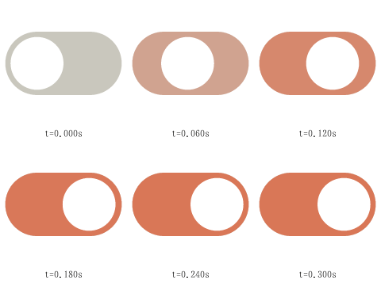

# Getting started

This walks through one small control, a toggle switch, from an empty file to a working web page. It
takes about ten minutes. Every command below was run on the finished example,
[`examples/switch.animl`](../examples/switch.animl).

You need Node 24 and a checkout of this repository. The packages are not published yet, so the CLI
runs from source:

```sh
git clone https://github.com/MRoiban/anima && cd anima
npm ci
npx --no anima doctor        # checks Node, the headless browsers and the module wiring
```

`npx --no anima` is the workspace binary (`node packages/cli/src/main.ts` is the same program). Keep
the `--no`: it stops npx from downloading anything, and the npm package named `anima` is an
unrelated project. Outside a clone, install the CLI with `npm install --save-dev animl-cli` (then
`npx --no anima …`), or run it once with `npx -p animl-cli anima …` or `npx animl-cli …`.

## 1. Write the scene

An Anima scene is a small document: shapes, the inputs it reacts to, and how it moves between
states. You write it in **AniML**, an XML markup, and compile it to **`.ani`**, a JSON format the
runtime loads. Save this as `switch.animl`:

```xml
<anima version="0.1" name="switch" title="Switch" grid="24" viewBox="0 0 24 14">
  <color name="track" value="#c9c7bd"/>
  <color name="accent" value="#d97757"/>
  <color name="knob" value="#ffffff"/>
  <bool name="on"/>
  <a11y role="switch" label="Notifications" activate="on" pressed="on"/>

  <path id="bg" d="M7 1H17A6 6 0 0 1 17 13H7A6 6 0 0 1 7 1Z" fill="track"/>
  <path id="lit" d="M7 1H17A6 6 0 0 1 17 13H7A6 6 0 0 1 7 1Z" opacity="0" fill="accent"/>
  <circle id="thumb" cx="7" cy="7" r="5" fill="knob"/>

  <layer name="switch" initial="off">
    <state name="off">
      <on when="on" to="on" blend="0.2" ease="out"/>
    </state>
    <state name="on">
      <pose thumb.x="10" lit.opacity="1"/>
      <on when="!on" to="off" blend="0.2" ease="out"/>
    </state>
  </layer>
  <listener on="click" toggle="on"/>
</anima>
```

What each part does:

- **`grid` and `viewBox`.** Coordinates are grid units, as in an icon design tool: 24 units across.
  The drawing area is 24 × 14 units. On the page, the element keeps that aspect ratio.
- **`<color>`.** Named colour *slots*. On a page each one becomes a CSS custom property
  (`--anima-accent`), so you can theme the control without touching the file.
- **`<bool name="on">`.** An *input*: the state the page, the user or the scene itself can change.
- **`<a11y>`.** Makes the element a real `role="switch"`, with `aria-checked` following `on`. Space
  and Enter toggle `on`, as on a native switch.
- **Shapes.** Two copies of the track (grey, and orange at opacity 0) and a white thumb.
- **`<layer>` with two `<state>`s.** `off` writes nothing, so everything shows its authored values.
  `on` is a *pose*: the thumb moves 10 units right and the orange track fades in. `<on when=…>`
  is a transition; `blend="0.2"` cross-fades between the two poses over 0.2 s.
- **`<listener on="click" toggle="on"/>`.** A click flips the input.

## 2. Check it

```sh
npx --no anima validate switch.animl
```

prints `switch.animl: ok`. When something is wrong, every problem has a line and column, a code, a
JSON pointer and usually a hint:

```text
switch.animl:18:17 error bad-condition "not on": cannot read "not on"
  hint: "not" and "or" are bind-expression syntax: write !name, and one transition per "or" branch
switch.animl: 1 error
```

`npx --no anima inspect switch.animl` summarises what the file contains: nodes and what animates them,
inputs, and the state graph with its transitions.

## 3. See it move, without a browser

`sample` runs the scene headlessly and prints values as JSON lines. A script is one command per line:

```sh
npx --no anima sample switch.animl -e "toggle on
advance 0
advance 0.1
snapshot thumb.x
advance 0.1
snapshot thumb.x"
```

```text
{"time":0.1,"values":{"thumb.x":6.846431874274607},"states":{"switch":"on"},"events":[],"settled":false}
{"time":0.2,"values":{"thumb.x":10},"states":{"switch":"on"},"events":[],"settled":true}
```

Halfway through the blend, the thumb is at 6.8 units, eased out. At 0.2 s it has arrived and the
scene reports `settled`, so the runtime stops drawing until something changes. Playback is
deterministic: the same script always prints the same numbers.

`render` draws frames to PNG. `--sheet 6` lays out six frames of a time range:

```sh
npx --no anima render switch.animl -o sheet.png --sheet 6 --over 0.3 -e "toggle on"
```



For live editing, `npx --no anima playground switch.animl` opens a local editor with the preview,
diagnostics and inspectors.

## 4. Put it on a page

Compile it to `.ani`:

```sh
npx --no anima build switch.animl -o switch.ani
```

Then load the runtime and use the `<anima-icon>` element:

```html
<script type="module" src="anima-icon.js"></script>
<anima-icon src="switch.ani" style="font-size: 48px; --anima-accent: #2f6fde"></anima-icon>
```

`anima-icon.js` is the base runtime (about 23 KB gzipped). `node tools/build-web.ts` builds it into
`packages/web/dist/`. This switch needs nothing else: shapes, states, blends, listeners, colour
slots and the switch role are all built in.

- **Size:** the element is `1em` wide, so `font-size` sizes it; or give it a `width`.
- **Theme:** `--anima-accent` overrides the slot's default. `color` drives `currentColor`.
- **Script it:**

  ```js
  const sw = document.querySelector('anima-icon');
  await sw.ready;
  sw.set('on', true); // drive the input from your app
  sw.addEventListener('anima:state', (e) => console.log(e.detail));
  ```

  `set()`, `fire()` and `toggle()` called before the scene has loaded are queued in call order.
  To show a control already on without animating it in, call `set('on', true)` and then `settle()`.
- **Reduced motion:** honoured automatically.

The whole host API is in [WEB.md](WEB.md).

To try it without writing any HTML, `npx --no anima build switch.animl --out-dir site` writes a
self-contained page with the runtime next to it. Serve that folder over HTTP: browsers don't load
modules from `file://`.

## 5. Use more features

The base runtime covers shapes, paths, timelines, states, inputs and listeners. Everything else is
an optional module: a scene declares what it uses, and the page loads only that.

```xml
<anima version="0.1" name="card" grid="24" requires="paint text layout">
```

For example, `paint` adds gradients and rounded corners, `text` text, and `layout` row and column
stacks. A scene that declares a feature the page didn't load fails with `unknown-feature`, and the
hint names the import to add. Load each module after the base runtime:

```html
<script type="module" src="anima-icon.js"></script>
<script type="module" src="anima-paint.js"></script>
```

To ship one file, bundle exactly the modules you need:

```sh
npx --no anima bundle --modules paint,text,layout -o anima.js
```

[FEATURES.md](FEATURES.md) lists every feature, what it adds and what it costs.

## Where to go next

- [AUTHORING.md](AUTHORING.md): the full guide to writing scenes, also served by
  `npx --no anima docs <topic>` (`npx --no anima docs --list` lists the topics).
- [FEATURES.md](FEATURES.md): every optional feature, with its import and size.
- [WEB.md](WEB.md): the `<anima-icon>` element, attributes, methods and events.
- [FOR-AGENTS.md](FOR-AGENTS.md): the same workflow for coding agents, with JSON output.
- [`spec/SPEC.md`](../spec/SPEC.md): the normative format.
- [`examples/`](../examples/): finished scenes, each with its AniML source and compiled `.ani`.
